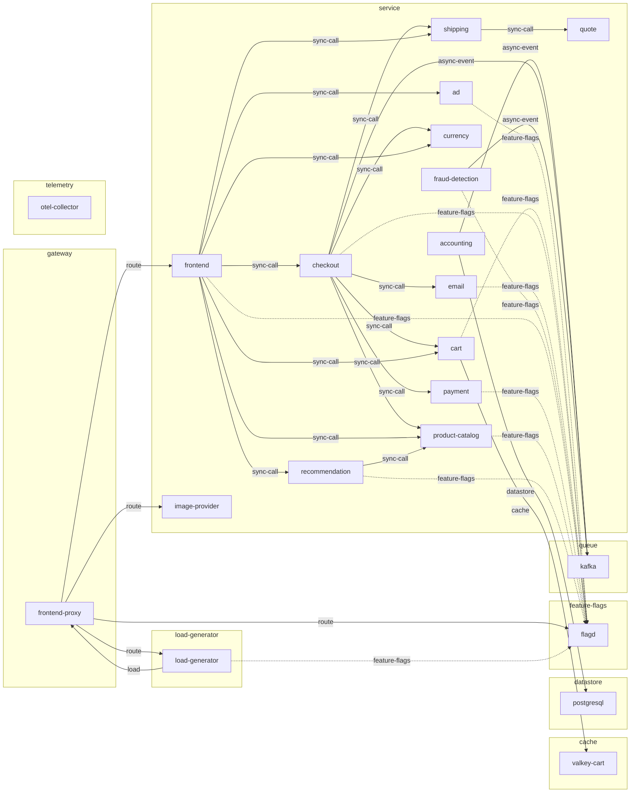

# System index

What this deployment is made of and how its parts connect. This wiki holds
no live state: for what is running now, ask the cluster.

## Overview

This is a microservice web-shop deployment whose components reach one another over addresses supplied as environment variables (for example CART_ADDR, PRODUCT_CATALOG_ADDR, KAFKA_ADDR). [derived: edges] [env: CART_ADDR] [env: PRODUCT_CATALOG_ADDR] [env: KAFKA_ADDR]

All externally reachable traffic enters through frontend-proxy, which forwards to the frontend web application, the image-provider, the flagd feature-flag host and UI, and the load-generator web interface. [derived: edges] [env: FRONTEND_HOST] [env: IMAGE_PROVIDER_HOST] [env: FLAGD_HOST] [env: FLAGD_UI_HOST] [env: LOCUST_WEB_HOST]

The only declared traffic source inside the deployment is load-generator, which drives requests at frontend-proxy via LOCUST_HOST. [derived: edges] [derived: callers] [env: LOCUST_HOST]

Order flow fans out from frontend to ad, cart, checkout, currency, product-catalog, recommendation and shipping; checkout in turn calls cart, currency, email, payment, product-catalog and shipping and publishes to kafka, which accounting and fraud-detection consume. [derived: edges] [derived: callers]

Persistent and keyed state lives in postgresql (used by accounting) and valkey-cart (used by cart); most services read feature flags from flagd. [derived: edges] [derived: callers] [env: DB_CONNECTION_STRING] [env: VALKEY_ADDR] [env: FLAGD_HOST]

## Structure

## Components

**cache:** [valkey-cart](components/valkey-cart.md)

**datastore:** [postgresql](components/postgresql.md)

**feature-flags:** [flagd](components/flagd.md)

**gateway:** [frontend-proxy](components/frontend-proxy.md)

**load-generator:** [load-generator](components/load-generator.md)

**queue:** [kafka](components/kafka.md)

**service:** [accounting](components/accounting.md), [ad](components/ad.md), [cart](components/cart.md), [checkout](components/checkout.md), [currency](components/currency.md), [email](components/email.md), [fraud-detection](components/fraud-detection.md), [frontend](components/frontend.md), [image-provider](components/image-provider.md), [payment](components/payment.md), [product-catalog](components/product-catalog.md), [quote](components/quote.md), [recommendation](components/recommendation.md), [shipping](components/shipping.md)

**telemetry:** [otel-collector](components/otel-collector.md)

Built from the sources in [sources.md](sources.md); what changed between
builds is in [log.md](log.md).
